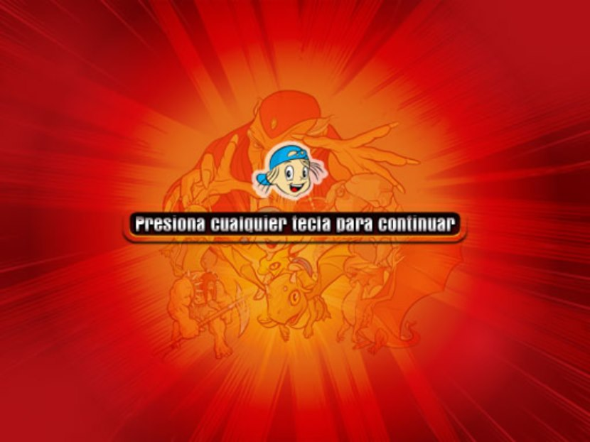

<p align="center">
  
</p>

<h1 align="center">Vascolet 2</h1>

<p align="center">
  <a href="https://frajusu.github.io/vascolet-exe-2/">▶ Abrir Vascolet 2 en el navegador</a>
</p>



## Descripción

Este sitio corre **el ejecutable original de Vascolet 2** —el mismo `.exe` de Windows, sin modificarlo— directamente en el navegador. No es un port ni una reescritura: el programa y sus recursos viajan tal cual y se ejecutan con dos motores intercambiables desde el menú ☰:

- **Recompilado a WebAssembly** (lo que elige *Automático*): el binario se recompila una vez y corre como wasm nativo del navegador; es la opción más rápida y la recomendada.
- **Boxedwine + Wine 11**: emulación del entorno de Windows con JIT multihilo (SharedArrayBuffer y OffscreenCanvas) y respaldo de un solo hilo. CheerpX queda como experimento cuando el navegador permite aislamiento.

El arranque es directo del EXE, sin consola `cmd` ni procesos `reg` en cada inicio. La primera visita descarga el juego —y, en el motor Wine, también Wine—; después quedan en caché. Un service worker habilita COOP/COEP en GitHub Pages y pide una recarga automática la primera vez.

## Características

- Menú ☰: motor, sonido, pantalla completa, controles táctiles, reasignación de teclas, guardado y diagnóstico descargable.
- Botones 1–4 para cambiar de Vascolet: cada juego mantiene sus archivos por separado.
- Controles táctiles para celular: cruceta con diagonales, **Saltar (Espacio)**, **Enter** y **Esc**; se pueden mantener varios botones a la vez. Tocá directamente el juego para usar sus menús.
- Partidas guardadas en IndexedDB, con exportar/importar copia JSON desde el menú. `localStorage` guarda solo preferencias (motor y sonido).
- Pantalla dedicada al juego; las opciones están en el botón ☰.

## Cómo jugar

1. Abrí [frajusu.github.io/vascolet-exe-2](https://frajusu.github.io/vascolet-exe-2/).
2. Dejá **Automático** en el motor y hacé clic dentro del juego para habilitar teclado y audio.
3. En celular, activá los controles táctiles desde el menú ☰.

Requiere Chrome, Edge o Firefox actualizado. La primera carga puede tardar unos segundos; las siguientes usan la caché local.

## Desarrollo

```sh
python build.py
python -m http.server 8000 --directory dist
```

Python 3.11+ e internet para el primer build. Actions construye `dist/` y publica GitHub Pages en cada push a `main`. Los originales se verifican con los SHA-256 de `game-manifest.json` y las descargas con `runtime.lock.json`.

## Licencias y originales

- Los EXE no se modificaron. **Vascolet** y sus recursos pertenecen a sus autores originales.
- Boxedwine es GPL-2.0-or-later: ver `vendor/Boxedwine-COPYING.txt`. Wine se usa sin distribuir Microsoft Windows.
- Notas de compatibilidad y mediciones en `TESTING.md` y `docs/`.
